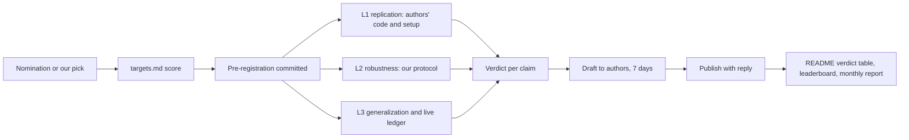
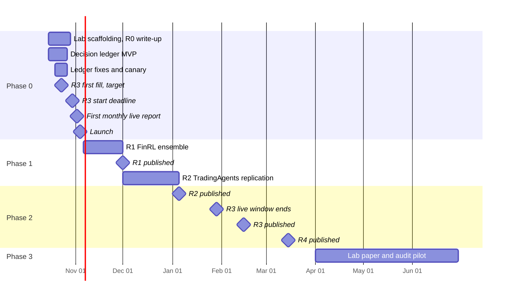

# RL-pricing plan: the reproducibility lab for trading AI

Status: 2026-10-25; audit and next steps in
[`phase-0-foundations.md`](phase-0-foundations.md#status-2026-10-25). Owner:
Bicheng Wang. This directory is the source of truth for direction; change
[`decisions.md`](decisions.md) first when direction changes.

| File | Contents |
| --- | --- |
| [`decisions.md`](decisions.md) | Every direction decision, its date, reason and what would reopen it |
| [`lab-protocol.md`](lab-protocol.md) | How a reproduction is run, judged and published |
| [`targets.md`](targets.md) | Which published claims we re-test, scored, with sources |
| [`phase-0-foundations.md`](phase-0-foundations.md) | 2026-10-15 → 2026-11-05: lab scaffolding, live ledger, launch |
| [`phase-1-first-reports.md`](phase-1-first-reports.md) | 2026-11-06 → 2026-12-31: FinRL ensemble, TradingAgents replication |
| [`phase-2-live-verdicts.md`](phase-2-live-verdicts.md) | 2027-01-01 → 2027-03-31: TradingAgents live verdict, fourth report, site |
| [`phase-3-authority.md`](phase-3-authority.md) | 2027-04-01 → 2027-06-30: lab paper, paid audit pilot, community nominations |

## Identity

> RL-pricing re-tests published trading-AI claims under one honest,
> pre-registered protocol and publishes every verdict, positive or negative,
> next to the authors' reply. The leaderboard and the live track are the lab's
> instruments, not the headline.

Why this identity, from evidence gathered on 2026-10-12/14:

- The field's credibility problem is documented. FinRL contest tables mix Sharpe
  definitions that differ by about 25×; TradingAgents' authors attribute their
  Sharpe of 8.2 to "few pullbacks" in a three-month window; ai-hedge-fund issue
  #720 measured LLM recall of the backtest period in 10 of 12 models; a 2026
  paper excluded RD-Agent(Q) because it selects alphas on the window it reports.
- We already did it to ourselves. Report R0 re-ran our own preprint 75 times:
  the 55.5% return does not reproduce, the Sharpe ratios are best-of-five seeds,
  and only SAC stays ahead of 1/N (not significantly). That earns the right to
  re-test others.
- Every target sits in a repository with an existing audience (3k–111k stars),
  so each report has readers on day one.

## Where we start

| Fact (2026-10-14) | Value |
| --- | --- |
| Shipped | `rl/bench` (3,560 lines), 299 tests, CI green; PRs #84, #85 merged |
| Live track | 39 frozen policies, published by CI 2026-10-14 17:09 UTC; first monthly run 2026-11-02 |
| Evidence | `leaderboard/reproductions/paper-2021-share-env.json` (50 runs), historical records for 13 submissions × 4 tasks |
| Stars | 37 (45 on 2026-10-12; cause of the drop unknown). 25 starred in October |
| Metadata | No GitHub description or topics yet |
| PyPI | `rl-pricing` unclaimed |

## What the repository looks like at month six

A visitor lands on a verdict table, not a leaderboard:

```markdown
# RL-pricing: the reproducibility lab for trading AI

| Report | Claim tested | Verdict | Authors' reply |
| --- | --- | --- | --- |
| R0 Wang & Zhang 2026 (ours) | DDPG 55.5%/yr, Sharpe 1.38 | ◐ partly holds | – |
| R1 FinRL ensemble, ICAIF 2020 | Sharpe 1.30 vs DJIA 0.47 | … | … |
| R2 TradingAgents backtest | Sharpe 5.6–8.2, Q1 2024 | … | … |
| R3 TradingAgents, 3 months live | same agent, prospective | … | … |
```

Each row links to `reports/<id>/`: the pre-registration (committed before any
run), the evidence files, the verdict per claim, the authors' reply verbatim,
and one command that reproduces our numbers.



## Target repository layout

The current layout stays (decision 2026-10-14). Additions only:

```text
RL-pricing/
├── reports/                         # NEW: the product
│   ├── README.md                    # verdict table (generated) and how to nominate
│   ├── TEMPLATE.md
│   └── r0-wang-zhang-2026/
│       ├── preregistration.md       # committed before runs (R0: marked post hoc)
│       ├── claims.json              # claim text, source, metric, value, verdict
│       ├── report.md
│       ├── reply.md                 # authors' reply, verbatim
│       └── evidence/                # per-seed JSON, manifests, commands
├── rl/bench/
│   ├── ledger.py                    # NEW: committed daily decisions → engine replay
│   ├── monthly.py                   # NEW: monthly live report
│   ├── verdicts.py                  # NEW: verdict table from every claims.json
│   └── policies/tradingagents.py    # NEW: TradingAgents adapter
├── submissions/<id>/ledger/<task>/YYYY-MM-DD.json   # NEW: prospective decisions
├── leaderboard/reports/YYYY-MM.md   # NEW: monthly live report
└── .github/workflows/ledger.yml     # NEW: daily pre-open decision commits
```

## Instruments

| Instrument | Status | Needed for |
| --- | --- | --- |
| Engine, tasks, scoring, multi-seed runner | ✅ | Every L2 test |
| Live track (freeze, CI publication, monthly replay) | ✅ | Leaderboard policies |
| Share-trading toolkit (`--mode train/ensemble`) | ✅ | R0, R1 replication |
| Decision ledger (daily, committed before the open) | ◐ Records on GitHub since #98 (2026-10-25); canary verifying, R3 waits for its gate (P0.15) | R3 and any LLM agent |
| Reports scaffolding and verdict table | ✅ | All reports |
| Licensed survivorship-free US equities | ◐ Sharadar chosen; written confirmation pending (P0.6) | R1 (Dow 30 as of 2016 includes delisted names) |
| CI-computed historical records, protocol version on records | 🔜 Phase 1 | Third-party submissions |
| Probability of backtest overfitting (CPCV) | 🔜 Phase 2 | Claims based on selection |

## Calendar



## Budget (approved 2026-10-14: APIs and licensed data)

| Line | Use | Estimate (to confirm) |
| --- | --- | --- |
| LLM APIs | TradingAgents daily on 3 tickers (about 31 model and tool calls per ticker per day), R2 replication, recall probes | $30–300/month, model-dependent; hard monthly cap in the workflow |
| Licensed market data | Survivorship-free US equities with publication rights for derived results | Choose in Phase 0 (`phase-0-foundations.md` P0.6) |
| Compute | M5 laptop for training sweeps; GitHub Actions for CI, ledger, live | $0 |

## Success measures

| By | Reports | Engagement | Stars (estimate, not a promise) |
| --- | --- | --- | --- |
| 2026-11-15 | R0 published, ledger live | Launch posts out, authors of R1–R2 contacted | 300 |
| 2026-12-31 | R1 published on schedule | At least one authors' reply printed | 1,000 |
| 2027-03-31 | R2, R3, R4 published | Two outside citations or write-ups | 2,500 |
| 2027-06-30 | Lab paper submitted | One paid audit delivered | 4,000 |

Reference points: TradeMaster 3.1k, SWE-bench 6.0k, FinRL 16.6k, AI-Trader
22.8k, TradingAgents 111k stars (2026-10-14).

## Risks

| Risk | Mitigation |
| --- | --- |
| Authors object or feel attacked | 7-day notice, reply printed verbatim, corrections policy, neutral verdict wording |
| A verdict is wrong | Pre-registration, one-command reproduction, corrections log in the report |
| LLM results contaminated by training data | Only models with a documented cutoff before the window count historically; otherwise only the live ledger counts |
| Live ledger misses an open (Actions delay, API outage) | Three runs before the open, Mon–Fri at 04:17, 07:17 and 10:17 UTC: the 12:00 UTC cron started 2 h 41 m to 3 h 48 m late on its first three runs. Outside `workflow_dispatch` as fallback; a zero-cost canary participant shows breakage first. A missed day is a hold, never back-filled |
| A paid agent runs without its keys or cap | Preflight (P0.13): nothing is written and the job fails before the open |
| Data licence forbids publishing results | Licence review before purchase (P0.6); publish derived metrics only |
| API spend overruns | Per-run cost logging and a hard monthly cap that stops the ledger job |
| Low statistical power on short windows | Every report states the smallest effect it could detect |
| Maintainer time | One report per month maximum; nominations queue in issues |
