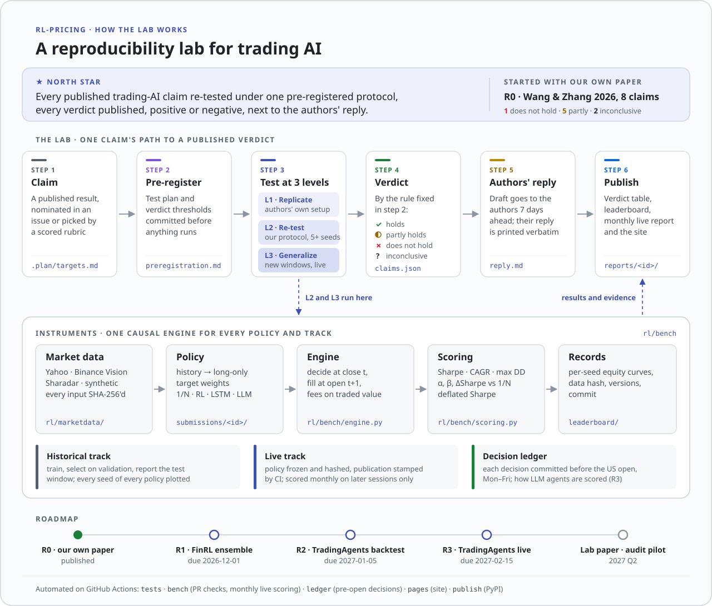
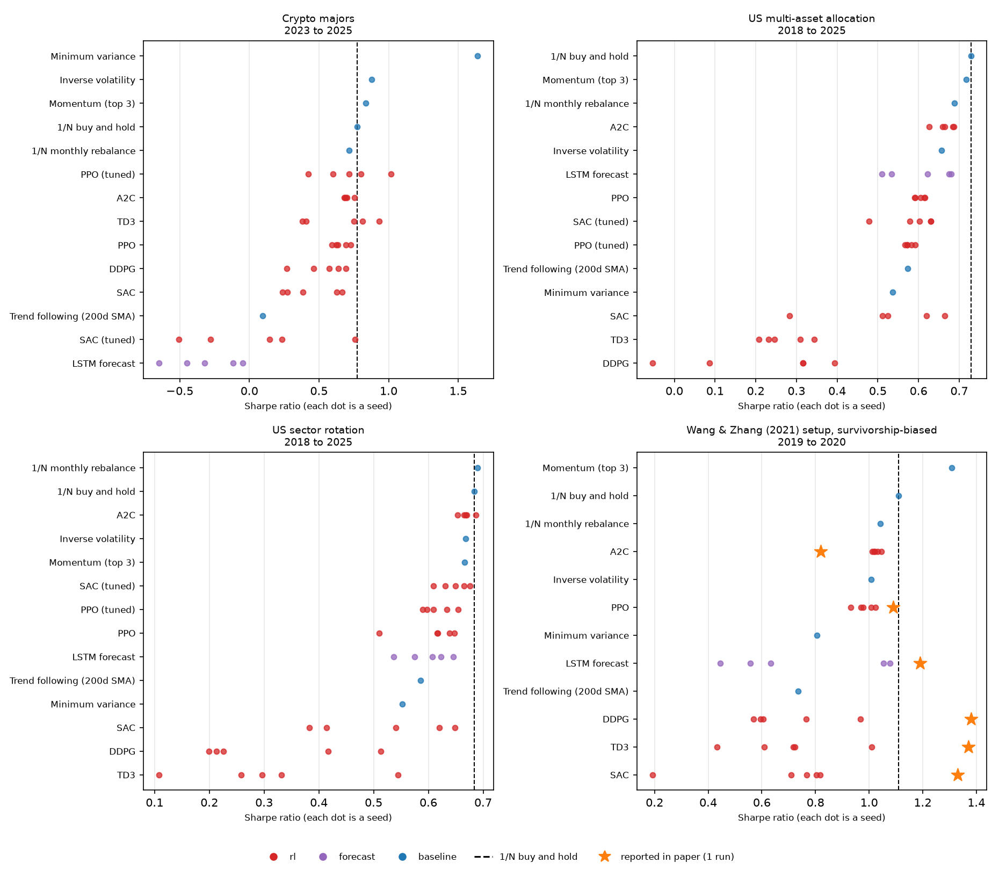

# RL-pricing: a reproducibility lab for trading AI

<p align="center">
  <strong>Published trading-AI claims, re-tested under one pre-registered protocol.</strong><br>
  Every verdict is published next to the authors' reply, including the verdicts against our own paper.
</p>

<p align="center">
  <a href="https://github.com/BichengWang/RL-pricing/actions/workflows/tests.yml"></a>
  <a href="https://github.com/BichengWang/RL-pricing/actions/workflows/bench.yml"></a>
  <a href="https://pypi.org/project/rl-pricing/"></a>
  <a href="https://arxiv.org/abs/2609.31870"></a>
  <a href="https://bichengwang.github.io/RL-pricing/"></a>
  <a href="https://github.com/BichengWang/RL-pricing/blob/main/LICENSE"></a>
</p>

<p align="center">
  <a href="#verdicts">Verdicts</a> ·
  <a href="#r0-our-own-paper">R0: our own paper</a> ·
  <a href="#benchmark-findings">Findings</a> ·
  <a href="#leaderboard">Leaderboard</a> ·
  <a href="#quick-start">Quick start</a> ·
  <a href="#submit-a-policy">Submit a policy</a> ·
  <a href="https://bichengwang.github.io/RL-pricing/">Site</a>
</p>



Three public instruments back every verdict: a causal backtesting benchmark,
a live track scored only on market data that did not exist when a policy was
published, and a ledger of decisions committed before each US market open.

## Verdicts

<!-- reports:start -->
| Report | Claim | Level | Claimed | Ours (95% interval) | Verdict |
| --- | --- | --- | --- | --- | --- |
| [r0-wang-zhang-2026](reports/r0-wang-zhang-2026/report.md) | `ddpg-annual-return` (annual_return) | L2 | 55.5% | 24.6% [17.3%, 31.9%] | ✗ does not hold |
| [r0-wang-zhang-2026](reports/r0-wang-zhang-2026/report.md) | `ddpg-sharpe` (sharpe) | L2 | 1.38 | 1.16 [0.93, 1.39] | ◐ partly holds |
| [r0-wang-zhang-2026](reports/r0-wang-zhang-2026/report.md) | `td3-sharpe` (sharpe) | L2 | 1.37 | 1.10 [0.69, 1.52] | ◐ partly holds |
| [r0-wang-zhang-2026](reports/r0-wang-zhang-2026/report.md) | `sac-sharpe` (sharpe) | L2 | 1.33 | 1.23 [1.07, 1.39] | ◐ partly holds |
| [r0-wang-zhang-2026](reports/r0-wang-zhang-2026/report.md) | `ppo-sharpe` (sharpe) | L2 | 1.09 | 1.17 [0.90, 1.44] | ◐ partly holds |
| [r0-wang-zhang-2026](reports/r0-wang-zhang-2026/report.md) | `a2c-sharpe` (sharpe) | L2 | 0.82 | 1.09 [0.91, 1.27] | ◐ partly holds |
| [r0-wang-zhang-2026](reports/r0-wang-zhang-2026/report.md) | `lstm-max-drawdown` (max_drawdown) | L2 | -9.6% | -26.5% [-29.4%, -23.7%] | ? inconclusive |
| [r0-wang-zhang-2026](reports/r0-wang-zhang-2026/report.md) | `lstm-sharpe` (sharpe) | L2 | 1.19 | 0.75 [0.39, 1.12] | ? inconclusive |

Verdicts: ✅ holds, ◐ partly holds, ✗ does not hold, ? inconclusive. [How a verdict is decided](reports/README.md#how-a-verdict-is-decided).
<!-- reports:end -->

**Next up**

| Report | Claim under test | Due |
| --- | --- | --- |
| R1 | FinRL ensemble ([Yang et al., ICAIF 2020](https://arxiv.org/abs/2511.12120)): Sharpe 1.30 vs the DJIA's 0.47, 2016–2020 | 2026-12-01 |
| R2 | [TradingAgents](https://arxiv.org/abs/2412.20138) backtest: Sharpe 5.6–8.2 on AAPL, GOOGL, AMZN in 2024 Q1, replicated with a check for whether the models remember that period | 2027-01-05 |
| R3 | TradingAgents run live on the same three stocks for three months, each decision committed before the open; first fill 2026-10-29 ([pre-registration](reports/r3-tradingagents-live/preregistration.md), [addendum](reports/r3-tradingagents-live/addendum-2026-10-29.md)) | 2027-02-15 |

**Nominate a claim:** open an issue titled `Nominate: <paper>` with the
quoted claim and a link to the code. Authors get each draft seven days before
publication.

## How the lab works

- **Pre-registered.** Each report's test plan is committed before anything
  runs; the commit time is the evidence that the plan came first.
- **Three levels.** L1 replicates with the authors' code and setup. L2
  re-tests under this repository's protocol: next-open fills, fees, at least
  five seeds, survivorship-free data. L3 tries new windows and, for anything
  that can run daily, the live ledger.
- **Verdicts by rule:** holds, partly holds, does not hold, or inconclusive,
  decided by thresholds fixed in the pre-registration
  ([rules and template](reports/README.md)).
- **LLM agents only count live.** Their historical backtests can be
  contaminated by training data. The ledger commits each decision before the
  open, and scoring checks the commit against GitHub's own run records.
- **Evidence is committed.** Each report ships its per-seed results, input
  hashes and one command that reproduces them.

## R0: our own paper

Full report: [`reports/r0-wang-zhang-2026/report.md`](reports/r0-wang-zhang-2026/report.md).

Our preprint ([Wang & Zhang, arXiv:2609.31870](https://arxiv.org/abs/2609.31870))
reported DDPG with a 55.5% annual return and Sharpe 1.38 on 20 large-cap
stocks in 2019–2020, with TD3 and SAC close behind. Those are single runs on a
universe picked in 2021 from the largest companies, which the paper itself
lists as limitations.

We re-ran it three ways, 5 seeds per agent, same 20 stocks, same 2019–2020
window, 0.1% fees:

- **Share env + crash rule**: the paper's own share-trading environment
  (`python main.py --mode train`, now with next-open fills), including its
  default rule that sells everything when a market-turbulence index spikes.
- **Share env, no rule**: the same with `--no-turbulence`.
- **Benchmark**: this repository's `paper-2021` task (portfolio weights, no
  hand-coded exits).

Sharpe ratio, mean ± sd over 5 seeds [best seed]:

| Agent | Reported (1 run) | Share env + crash rule | Share env, no rule | Benchmark |
| --- | --- | --- | --- | --- |
| DDPG | 1.38 | 1.16 ± 0.19 [1.43] | 1.06 ± 0.18 [1.24] | 0.70 ± 0.17 [0.97] |
| TD3 | 1.37 | 1.10 ± 0.34 [1.37] | 1.00 ± 0.30 [1.37] | 0.70 ± 0.21 [1.01] |
| SAC | 1.33 | 1.23 ± 0.13 [1.42] | 1.23 ± 0.18 [1.49] | 0.66 ± 0.26 [0.82] |
| PPO | 1.09 | 1.17 ± 0.21 [1.32] | 0.95 ± 0.21 [1.21] | 0.98 ± 0.04 [1.02] |
| A2C | 0.82 | 1.09 ± 0.15 [1.27] | 0.97 ± 0.15 [1.16] | 1.03 ± 0.01 [1.05] |
| LSTM forecast | 1.19 | – | – | 0.75 ± 0.29 [1.08] |
| *1/N buy and hold* | – | *1.10* | *1.10* | *1.11* |

What holds up and what doesn't:

- **The 55.5% return does not.** The best of the 50 share-environment runs
  earned 46% a year and the median 26%. Holding the 20 stocks in equal
  weight earned 29.7%, so the hindsight-chosen universe and the 2019–2020
  bull market account for most of the headline.
- **The Sharpe ratios are best-of-five, not typical.** Values like the
  reported 1.33–1.38 show up as the best seed for most agents.
- **The crash rule is not learning.** With it on, all 25 runs were moved to
  cash on the same five sessions of March 2020 by the environment, not the agent.
  Switching it off drops every agent's mean Sharpe except SAC's below 1/N.
- **SAC is the one survivor, but not a significant one.** Without the rule
  its seed-averaged Sharpe is 1.32 against 1/N's 1.10, alpha 7.5% a year. Over
  a two-year window that is not significant (bootstrap p = 0.13, alpha
  *t* = 1.6).
- **The benchmark environment flips the picture.** There the same agents
  trail 1/N. Which difference drives that is open: share counts versus
  weights, the features, or the share environment's per-trade limits.

Per-seed results, equity curves, commands and the input-data hash are in
[`reports/r0-wang-zhang-2026/evidence/`](reports/r0-wang-zhang-2026/evidence/).

## Benchmark findings



Historical track, test windows 2018–2025 (US ETFs) and 2023–2025 (crypto),
Stable-Baselines3 agents with default and tuned hyperparameters, 5 seeds each:

- **No learned policy beats 1/N buy-and-hold here.** All 30 RL and LSTM entries
  across the four tasks have a lower seed-averaged Sharpe ratio than holding
  every asset in equal weight. Only 5 of their 150 individual seeds do better,
  so cherry-picking one would make a publishable-looking result.
- **Tuning doesn't close the gap.** A declared sweep of 8 configurations each
  for PPO and SAC, selected on validation data only, picks configurations that
  still trail 1/N on every task. SAC's choice helps on the US tasks and
  collapses on crypto (Sharpe 0.07 ± 0.49). The deflated Sharpe column
  accounts for the 8 trials.
- **The off-policy agents churn themselves to death.** SAC, TD3 and DDPG
  turn over 46–326× their equity per year. On the US tasks their alpha
  against 1/N is negative, with *t*-statistics down to −2.8.
- **A2C rediscovers 1/N.** Its five seeds on US sectors land at Sharpe
  0.67 ± 0.01 against 1/N's 0.68: the softmax policy learns to stay close to
  equal weights.
- **The one significant win is not RL.** In crypto, long-only minimum
  variance beats 1/N (ΔSharpe +0.86, bootstrap p < 0.001), mostly by holding
  the two least volatile coins, BTC (50% on average) and BNB (36%).

Better configurations are what the leaderboard is for: submit one, and state
how many you tried.

## Leaderboard

<!-- leaderboard:start -->
| Track | Task | # | Strategy | Sharpe | CAGR | Max DD | ΔSharpe vs 1/N | DSR |
| --- | --- | --- | --- | --- | --- | --- | --- | --- |
| historical | `crypto-majors` | 1 | Minimum variance | 1.64 | 90.9% | -33.3% | +0.86 (p<0.001) | 1.00 |
| historical | `crypto-majors` | 2 | Inverse volatility | 0.88 | 40.7% | -46.8% | +0.10 (p=0.089) | 0.94 |
| historical | `crypto-majors` | 3 | Momentum (top 3) | 0.84 | 37.8% | -47.9% | +0.06 (p=0.401) | 0.93 |
| historical | `crypto-majors` | 4 | **1/N buy and hold** ◆ | 0.78 | 32.7% | -44.5% | – | 0.91 |
| historical | `crypto-majors` | 6 | PPO (tuned) | 0.71 ± 0.22 | 26.9% | -49.3% | -0.04 (p=0.621) | 0.43 |
| historical | `us-multi-asset` | 1 | **1/N buy and hold** ◆ | 0.73 | 8.9% | -26.6% | – | 0.98 |
| historical | `us-multi-asset` | 2 | Momentum (top 3) | 0.72 | 9.9% | -23.7% | -0.01 (p=0.506) | 0.98 |
| historical | `us-multi-asset` | 3 | 1/N monthly rebalance | 0.69 | 8.0% | -25.8% | -0.04 (p=0.827) | 0.97 |
| historical | `us-multi-asset` | 4 | A2C | 0.66 ± 0.02 | 7.1% | -23.8% | -0.06 (p=0.940) | 0.97 |
| historical | `us-sectors` | 1 | 1/N monthly rebalance | 0.69 | 11.6% | -36.7% | +0.01 (p=0.449) | 0.97 |
| historical | `us-sectors` | 2 | **1/N buy and hold** ◆ | 0.68 | 11.5% | -35.5% | – | 0.97 |
| historical | `us-sectors` | 3 | A2C | 0.67 ± 0.01 | 10.3% | -34.3% | -0.01 (p=0.650) | 0.97 |
| historical | `paper-2021` (re-evaluation) | – | Momentum (top 3) | 1.31 | 48.6% | -30.4% | +0.20 (p=0.240) | 0.96 |
| historical | `paper-2021` (re-evaluation) | – | **1/N buy and hold** ◆ | 1.11 | 29.9% | -29.4% | – | 0.94 |
| historical | `paper-2021` (re-evaluation) | – | 1/N monthly rebalance | 1.04 | 26.7% | -29.5% | -0.07 (p=0.777) | 0.93 |
| historical | `paper-2021` (re-evaluation) | – | A2C | 1.03 ± 0.01 | 25.1% | -28.2% | -0.08 (p=0.825) | 0.92 |

Full tables: [leaderboard/LEADERBOARD.md](leaderboard/LEADERBOARD.md).
<!-- leaderboard:end -->

## Why trust these numbers

| | This benchmark | Common in RL-trading papers |
| --- | --- | --- |
| Execution | Decide at the close, fill at the next open, proportional fees | Fill at the same close used to decide; often no fees |
| Universe | Fixed ETFs; crypto top-10 by volume *before* the data starts, delistings included | Today's index members, back-tested into the past |
| Randomness | 5 seeds per learned policy, mean ± sd, every seed plotted | One run |
| Model selection | Validation window before the test; declared `trials` deflate the Sharpe | Tuned on the test period |
| Out-of-sample | Live track: frozen policy, scored only on sessions after its public freeze | One fixed historical window |
| Metrics | One implementation for everyone; beta and alpha against 1/N | Per-paper definitions |

The live track is the part nobody can overfit. A policy is fitted on all
data available today and its artifacts are committed with SHA-256 hashes. A
CI job on `main` then stamps the time the freeze became public
(`leaderboard/publications.json`, which pull requests may not edit), and
from then on it is scored monthly on sessions that start after that stamp.
The first live scores appear after the next monthly run.

## Quick start

Python 3.10 or newer:

```bash
git clone https://github.com/BichengWang/RL-pricing.git
cd RL-pricing
python -m venv .venv && source .venv/bin/activate
python -m pip install -e .

rl-pricing bench tasks                       # list tasks
rl-pricing bench run --task synthetic --submission momentum --out-root /tmp/board
rl-pricing bench run --task synthetic --submission ppo --seeds 2 --out-root /tmp/board
rl-pricing bench leaderboard --out-root /tmp/board --no-readme
```

The `synthetic` task is offline random walks with no edge by construction.
Real tasks download data on first use (`rl-pricing bench data us-sectors`)
into `datasets/bench/`. PPO takes one to two minutes per seed on a laptop CPU.

`pip install rl-pricing` installs the same commands without the reference
submissions or the published records. Point `--submissions-root` at your own
directory of submissions; the [PyPI page](https://pypi.org/project/rl-pricing/)
walks through one. Changes between releases are in
[`CHANGELOG.md`](CHANGELOG.md).

## Submit a policy

A policy maps the history up to today's close to long-only target weights,
which fill at the next open. Here is a complete one:

```python
# submissions/low-vol-half/policy.py
import numpy as np

from rl.bench.policy import Policy


class LowVolHalf(Policy):
    """Equal-weight the calmer half of the listed assets."""

    def act(self, view):
        closes = view.history.window(64).close
        vol = np.nanstd(np.diff(np.log(closes), axis=0), axis=0)
        vol = np.where(view.listed & np.isfinite(vol), vol, np.inf)
        keep = np.argsort(vol)[: max(1, view.listed.sum() // 2)]
        weights = np.zeros(len(view.tickers))
        weights[keep] = 1 / len(keep)
        return weights
```

```json
{
  "name": "Low-vol half",
  "kind": "other",
  "policy": "policy.py:LowVolHalf",
  "trials": 3,
  "authors": ["Your Name"],
  "description": "Equal-weight the half of the assets with the lowest 63-day volatility."
}
```

Learning policies implement `fit(history, validation_start, seed)` as well:
train on sessions before `validation_start`, select on the rest, and set
`stochastic = True` to be evaluated over several seeds. They also implement
`save`/`load` so the frozen live version can be restored. See
[`rl/bench/policies/sb3.py`](rl/bench/policies/sb3.py) for a full example.
Set `trials` honestly to the number of configurations you tried.

Then:

1. `rl-pricing bench validate` and `rl-pricing bench run --task <task> --submission <id>` locally.
2. Open a pull request with `submissions/<id>/` only: CI writes every record
   under `leaderboard/` and rejects pull requests that edit them. It checks
   that the submission builds and the baselines reproduce.
3. On merge, CI computes your historical records on every task with a live
   track and freezes the policy on today's data (or publishes your committed
   freeze from `rl-pricing bench freeze`); the monthly job scores it live
   from then on. A later change to the submission recomputes its records;
   editing only `description`, `authors` or `url` does not.

## Tasks

| Task | Universe | Test window | Fee per side | Why it is survivorship-free |
| --- | --- | --- | --- | --- |
| `us-sectors` | 9 SPDR sector ETFs | 2018–2025 | 5 bps | all listed since 1998 |
| `us-multi-asset` | SPY, QQQ, IWM, EFA, EEM, TLT, IEF, LQD, GLD, VNQ | 2018–2025 | 5 bps | all listed since 2004 |
| `crypto-majors` | top 10 Binance USDT pairs by Q2-2018 volume | 2023–2025 | 10 bps | chosen before the data starts; BCC and EOS delist mid-sample |
| `paper-2021` | the 2021 paper's 20 large caps | 2019–2020 | 10 bps | *it is not*: shown as a re-evaluation, not ranked |
| `synthetic` | 5 random walks | 2018–2019 | 10 bps | offline demo |

Each task trains before its validation window, selects on validation, and
reports the test window. Definitions live in [`rl/bench/tasks.py`](rl/bench/tasks.py).

## How scoring works

- **Execution** ([`rl/bench/engine.py`](rl/bench/engine.py)): targets set at
  close *t* fill at open *t+1* with fees solved exactly on traded notional.
  Weights are long-only and sum to at most one; the rest is cash at 0%. A
  delisted holding is sold at its last close. RL agents train in a gym
  environment that uses the same `Account`, so training and evaluation
  accounting are identical.
- **Metrics** ([`rl/bench/scoring.py`](rl/bench/scoring.py)): Sharpe, CAGR,
  max drawdown, annual turnover, and beta/alpha against 1/N (Newey-West *t*).
  ΔSharpe against 1/N comes with a paired stationary-bootstrap p-value. The
  deflated Sharpe ratio (Bailey & López de Prado) accounts for declared
  `trials`. Full definitions are in [`leaderboard/LEADERBOARD.md`](leaderboard/LEADERBOARD.md).
- **Records**: every run stores its daily equity curve per seed, data
  SHA-256, software versions and commit under `leaderboard/`, so all
  metrics can be recomputed.

## Data

US tasks use Yahoo Finance prices and dividends, downloaded to a local cache.
Yahoo's terms prohibit redistribution, so the repository ships no prices,
only derived results. Prices are adjusted for dividends forward from each
task's first session rather than taken from Yahoo's adjusted close, whose
last digits change between identical requests. A past session therefore
keeps its prices as new sessions arrive, and replaying the same window
reproduces its data hash; a changed hash means Yahoo revised its
history. Crypto uses
[Binance Vision](https://data.binance.vision) daily klines, each archive
verified against Binance's SHA-256 checksum. Binance Vision data is licensed
CC BY-NC-SA 4.0; the crypto results here derive from it, with attribution,
for non-commercial research.

## Limitations

- Fees are proportional; spread, market impact and borrowing costs are not
  modeled, and cash earns nothing.
- Daily bars only; adjusted prices model reinvested distributions rather
  than exact exchange fills.
- Eight-year and three-year test windows are a few market regimes, which is
  why the live track exists.
- Reference RL agents use one feature set
  ([`rl/bench/features.py`](rl/bench/features.py)), and only PPO and SAC
  get a hyperparameter sweep (8 configurations each); they are a floor, not
  the best RL can do.

## Training toolkit

The original FinRL-style training pipeline (share trading, portfolio
allocation, LSTM forecaster, rolling ensemble via `python main.py --mode ...`)
is still available and documented in [`docs/toolkit.md`](docs/toolkit.md).

## Development

```bash
pip install -e ".[test,lint]"
python -m pytest        # offline: synthetic data and fixtures
ruff check .
```

Use `type(scope): title` for pull request titles. The
[PR template](.github/pull_request_template.md) asks for a short summary and
verification results.

The [site](https://bichengwang.github.io/RL-pricing/) is built from this
repository by `mkdocs.yml` and deployed on every push to main. To preview it:
`pip install -r docs/requirements.txt && mkdocs serve`.

## Citing

GitHub's "Cite this repository" uses [`CITATION.cff`](CITATION.cff). The
original study is Wang & Zhang, *Deep Reinforcement Learning for Equity
Trading: Benchmarking Actor-Critic Methods with Forward Retraining*,
[arXiv:2609.31870](https://arxiv.org/abs/2609.31870)
([local PDF](docs/Wang_Zhang_2021_Deep_Learning_Stock_Trading_arxiv.pdf)).

```bibtex
@software{rl_pricing,
  author  = {Wang, Bicheng and Zhang, Xinyi},
  title   = {{RL-pricing}: an honest, live-forward-tested benchmark for reinforcement learning portfolio policies},
  version = {1.0.0},
  year    = {2026},
  url     = {https://github.com/BichengWang/RL-pricing}
}
```

## License

MIT; see [LICENSE](LICENSE). The training toolkit's environment,
preprocessing and training code are adapted from the MIT-licensed
[FinRL](https://github.com/AI4Finance-Foundation/FinRL) library.
