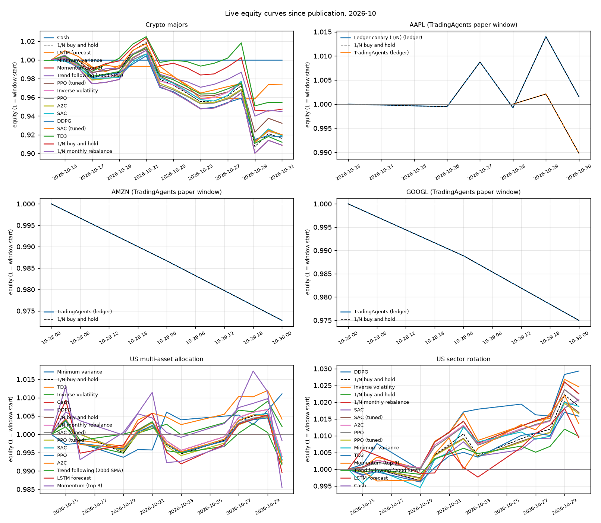

# Live report 2026-10

Window: 2026-10-14 (earliest publication or first decision) → 2026-10-31 (last session scored). Sessions scored: 2–17. 49 strategy-task pairs, 6 tasks.

Full tables: [LEADERBOARD.md](../LEADERBOARD.md).

## Findings

- 20 of 49 strategy-task pairs are ahead of 1/N since publication.
- Best versus 1/N: `crypto-majors: Cash` +9.1 pp (+0.0% vs -9.1% for 1/N, 17 sessions).
- Worst versus 1/N: `us-sectors: Cash` -2.2 pp (+0.0% vs +2.2% for 1/N, 12 sessions).

## Crypto majors — `crypto-majors`

| Strategy | Kind | From | Return | 1/N | vs 1/N | Sharpe | Max DD |
| --- | --- | --- | --- | --- | --- | --- | --- |
| Cash | baseline | 2026-10-15 | +0.0% | -9.1% | +9.1 pp | – (17 sessions) | 0.0% |
| LSTM forecast | forecast | 2026-10-15 | -2.7% | -9.1% | +6.5 pp | – (17 sessions) | -5.1% |
| Minimum variance | baseline | 2026-10-15 | -4.5% | -9.1% | +4.6 pp | – (17 sessions) | -7.2% |
| Momentum (top 3) | baseline | 2026-10-15 | -5.3% | -9.1% | +3.9 pp | – (17 sessions) | -7.6% |
| Trend following (200d SMA) | baseline | 2026-10-15 | -5.5% | -9.1% | +3.6 pp | – (17 sessions) | -7.3% |
| PPO (tuned) | rl | 2026-10-17 | -6.8% | -8.4% | +1.6 pp | – (15 sessions) | -8.8% |
| Inverse volatility | baseline | 2026-10-15 | -8.0% | -9.1% | +1.1 pp | – (17 sessions) | -9.9% |
| PPO | rl | 2026-10-15 | -8.0% | -9.1% | +1.1 pp | – (17 sessions) | -9.3% |
| A2C | rl | 2026-10-15 | -8.1% | -9.1% | +1.1 pp | – (17 sessions) | -9.7% |
| SAC | rl | 2026-10-15 | -8.1% | -9.1% | +1.0 pp | – (17 sessions) | -9.4% |
| DDPG | rl | 2026-10-15 | -8.2% | -9.1% | +0.9 pp | – (17 sessions) | -8.9% |
| SAC (tuned) | rl | 2026-10-17 | -8.0% | -8.4% | +0.4 pp | – (15 sessions) | -10.3% |
| TD3 | rl | 2026-10-15 | -8.8% | -9.1% | +0.3 pp | – (17 sessions) | -10.1% |
| 1/N buy and hold | baseline | 2026-10-15 | -9.1% | -9.1% | +0.0 pp | – (17 sessions) | -10.9% |
| 1/N monthly rebalance | baseline | 2026-10-15 | -9.1% | -9.1% | +0.0 pp | – (17 sessions) | -10.9% |

## AAPL (TradingAgents paper window) — `us-aapl`

| Strategy | Kind | From | Return | 1/N | vs 1/N | Sharpe | Max DD |
| --- | --- | --- | --- | --- | --- | --- | --- |
| Ledger canary (1/N) (ledger) | baseline | 2026-10-26 | +0.2% | +0.2% | +0.0 pp | – (5 sessions) | -1.2% |
| TradingAgents (ledger) | llm | 2026-10-29 | -1.0% | -1.0% | +0.0 pp | – (2 sessions) | -1.2% |

## AMZN (TradingAgents paper window) — `us-amzn`

| Strategy | Kind | From | Return | 1/N | vs 1/N | Sharpe | Max DD |
| --- | --- | --- | --- | --- | --- | --- | --- |
| TradingAgents (ledger) | llm | 2026-10-29 | -2.7% | -2.7% | +0.0 pp | – (2 sessions) | -2.7% |

## GOOGL (TradingAgents paper window) — `us-googl`

| Strategy | Kind | From | Return | 1/N | vs 1/N | Sharpe | Max DD |
| --- | --- | --- | --- | --- | --- | --- | --- |
| TradingAgents (ledger) | llm | 2026-10-29 | -2.5% | -2.5% | +0.0 pp | – (2 sessions) | -2.5% |

## US multi-asset allocation — `us-multi-asset`

| Strategy | Kind | From | Return | 1/N | vs 1/N | Sharpe | Max DD |
| --- | --- | --- | --- | --- | --- | --- | --- |
| Minimum variance | baseline | 2026-10-15 | +1.1% | -0.6% | +1.7 pp | – (12 sessions) | -0.6% |
| TD3 | rl | 2026-10-15 | +0.4% | -0.6% | +1.0 pp | – (12 sessions) | -0.8% |
| Inverse volatility | baseline | 2026-10-15 | +0.2% | -0.6% | +0.8 pp | – (12 sessions) | -0.7% |
| Cash | baseline | 2026-10-15 | +0.0% | -0.6% | +0.6 pp | – (12 sessions) | 0.0% |
| DDPG | rl | 2026-10-15 | -0.2% | -0.6% | +0.4 pp | – (12 sessions) | -1.1% |
| 1/N buy and hold | baseline | 2026-10-15 | -0.6% | -0.6% | +0.0 pp | – (12 sessions) | -1.3% |
| 1/N monthly rebalance | baseline | 2026-10-15 | -0.6% | -0.6% | +0.0 pp | – (12 sessions) | -1.3% |
| SAC (tuned) | rl | 2026-10-19 | -0.7% | -0.7% | +0.0 pp | – (10 sessions) | -1.2% |
| PPO (tuned) | rl | 2026-10-19 | -0.7% | -0.7% | +0.0 pp | – (10 sessions) | -1.2% |
| SAC | rl | 2026-10-15 | -0.7% | -0.6% | -0.1 pp | – (12 sessions) | -1.2% |
| PPO | rl | 2026-10-15 | -0.8% | -0.6% | -0.2 pp | – (12 sessions) | -1.2% |
| A2C | rl | 2026-10-15 | -0.8% | -0.6% | -0.2 pp | – (12 sessions) | -1.3% |
| Trend following (200d SMA) | baseline | 2026-10-15 | -0.8% | -0.6% | -0.2 pp | – (12 sessions) | -1.2% |
| LSTM forecast | forecast | 2026-10-15 | -1.0% | -0.6% | -0.4 pp | – (12 sessions) | -2.0% |
| Momentum (top 3) | baseline | 2026-10-15 | -1.5% | -0.6% | -0.8 pp | – (12 sessions) | -3.1% |

## US sector rotation — `us-sectors`

| Strategy | Kind | From | Return | 1/N | vs 1/N | Sharpe | Max DD |
| --- | --- | --- | --- | --- | --- | --- | --- |
| DDPG | rl | 2026-10-15 | +2.9% | +2.2% | +0.7 pp | – (12 sessions) | -0.8% |
| Inverse volatility | baseline | 2026-10-15 | +2.5% | +2.2% | +0.2 pp | – (12 sessions) | -0.8% |
| 1/N buy and hold | baseline | 2026-10-15 | +2.2% | +2.2% | +0.0 pp | – (12 sessions) | -0.6% |
| 1/N monthly rebalance | baseline | 2026-10-15 | +2.2% | +2.2% | +0.0 pp | – (12 sessions) | -0.6% |
| SAC | rl | 2026-10-15 | +2.1% | +2.2% | -0.2 pp | – (12 sessions) | -0.4% |
| SAC (tuned) | rl | 2026-10-19 | +1.7% | +1.9% | -0.2 pp | – (10 sessions) | -0.5% |
| A2C | rl | 2026-10-15 | +2.1% | +2.2% | -0.2 pp | – (12 sessions) | -0.6% |
| PPO | rl | 2026-10-15 | +2.0% | +2.2% | -0.2 pp | – (12 sessions) | -0.6% |
| PPO (tuned) | rl | 2026-10-19 | +1.7% | +1.9% | -0.2 pp | – (10 sessions) | -0.5% |
| Minimum variance | baseline | 2026-10-15 | +1.9% | +2.2% | -0.4 pp | – (12 sessions) | -0.5% |
| TD3 | rl | 2026-10-15 | +1.6% | +2.2% | -0.7 pp | – (12 sessions) | -0.4% |
| Momentum (top 3) | baseline | 2026-10-15 | +1.4% | +2.2% | -0.9 pp | – (12 sessions) | -0.9% |
| Trend following (200d SMA) | baseline | 2026-10-15 | +1.0% | +2.2% | -1.3 pp | – (12 sessions) | -0.2% |
| LSTM forecast | forecast | 2026-10-15 | +0.9% | +2.2% | -1.3 pp | – (12 sessions) | -0.9% |
| Cash | baseline | 2026-10-15 | +0.0% | +2.2% | -2.2 pp | – (12 sessions) | 0.0% |

*Return* is since the first scored session after publication (live) or after the first verified decision (ledger), net of fees. *1/N* is equal-weight buy and hold over the same sessions and *vs 1/N* is the difference of the two returns. *Sharpe* (daily returns, zero risk-free rate, annualised) is shown from 20 sessions. *Max DD* is peak-to-trough including the start.
